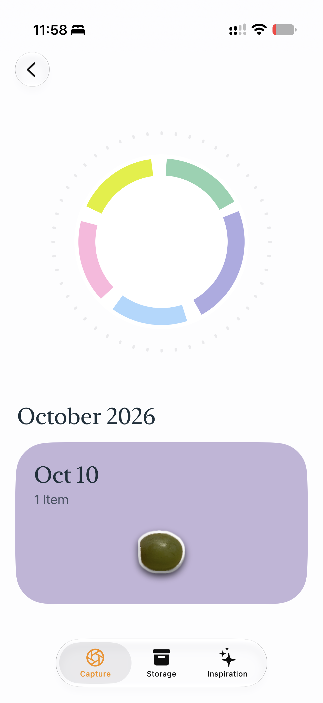
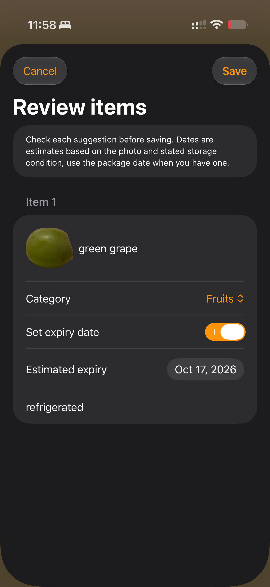
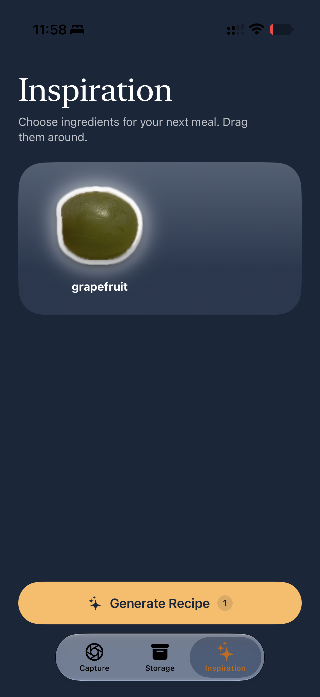

# Stuff

### See what you have. Get inspired to use it.

Stuff is a native iPhone app that turns grocery photos into a visual food inventory. Capture your ingredients, save them as cutout stickers, and choose what you want to cook with to generate a meal idea right on your iPhone.

Built as a capstone project by **Xiaoning Wang**, Stuff brings together SwiftUI, computer vision, local storage, and on-device generative AI in one everyday workflow.

**Capture → Review → Organize → Get inspired**

[Explore the features](#features) · [Run the app](#getting-started) · [Share feedback](https://github.com/xiaoning-wang-zone/Stuff/issues)

## Why Stuff?

It is easy to forget what you bought or run out of ideas for using it. Stuff explores a more visual way to keep track of food: your own photos become the inventory, and the ingredients you select become the starting point for your next meal.

The goal is to make everyday food organization more approachable and help people make better use of what they already have.

## A look inside

<table>
  <tr>
    <th>Capture history</th>
    <th>Review your items</th>
    <th>Find inspiration</th>
  </tr>
  <tr>
    <td></td>
    <td></td>
    <td></td>
  </tr>
</table>

Screenshots show the development app. Item names and dates are editable model suggestions.

## Features

- **Photograph or import.** Take a picture with the built-in camera or choose an image from your photo library.
- **Turn photos into stickers.** Apple Vision removes the background and creates transparent cutouts for detected foreground objects. Compare the result with the original before saving.
- **Get a head start on item details.** On supported iPhones, Apple Foundation Models suggests a food name, category, estimated shelf life, and storage assumption. Review and correct each suggestion before saving; manual entry remains available when the model cannot help.
- **Browse a visual inventory.** Explore 24 food categories with live item counts, sticker galleries, and item details. Revisit captures grouped by day, or delete items you no longer need.
- **Cook from your own selection.** Drag and select ingredient stickers in Inspiration, then generate a meal idea with the selected ingredients, any suggested additions, and preparation steps. The app can also explain when it cannot suggest a suitable meal.
- **Keep processing on your device.** Image segmentation, item suggestions, and recipe generation use Apple's on-device frameworks. Inventory records and images are stored locally; this implementation does not send photos or prompts to an app server.

## Try the workflow

1. Open **Capture** and tap the colorful circle.
2. Photograph a clearly visible food item or import a photo.
3. Inspect the background-free cutouts. Retake the photo if the objects are not separated well.
4. Review the name, category, and optional expiry date for each item, then save.
5. Open **Storage** to browse your inventory by category, or tap a date card in Capture to revisit that day's items.
6. Open **Inspiration**, select ingredients, and tap **Generate Recipe** on a supported iPhone with Apple Intelligence enabled.

**For a first demo:** use a well-lit photo with clearly separated ingredients, correct any suggested names, and select a small group of ingredients that you would normally cook together.

## Project status

Stuff is an **in-development capstone prototype**. Capture, foreground segmentation, editable item suggestions, local inventory storage, and recipe generation are implemented. The setup below runs the app from source.

### Current limitations

- Foreground segmentation separates visible objects; it does not identify food types. Nearby or overlapping items may become a single cutout, and some photos may produce no usable foreground.
- Automatic item suggestions and recipes depend on Apple Intelligence availability. When item analysis is unavailable, details can be entered manually; recipe generation reports that the model is unavailable.
- Expiry dates are estimates, not verified package dates or a measure of freshness. A photo cannot establish storage history. Check packaging and actual food condition, and correct dates when known.
- Generated recipes may need correction. Review ingredients, dietary needs, and preparation steps before cooking.
- Captures saved by older versions without SwiftData records do not automatically appear in the current inventory.

## Getting started

### Requirements

| Requirement | Details |
| --- | --- |
| Development environment | A Mac with Xcode and an iOS SDK that supports the APIs used by this checkout, including Foundation Models image attachments |
| Deployment target | **iOS 27.0**, as configured in `Stuff.xcodeproj` |
| Full AI experience | A compatible iPhone with Apple Intelligence enabled and its on-device model available |
| Camera capture | A physical iPhone; the Simulator can use the photo-library picker instead |
| Device signing | An Apple development team or Personal Team selected in Xcode |
| Dependencies | Apple system frameworks; no third-party packages or API keys are configured |

### Build and run

```sh
git clone https://github.com/xiaoning-wang-zone/Stuff.git
cd Stuff
open Stuff.xcodeproj
```

1. Select the **Stuff** target in Xcode.
2. Under **Signing & Capabilities**, enable automatic signing and select your team. If needed, use a unique bundle identifier for your local build.
3. Choose a compatible iPhone or iOS Simulator as the run destination.
4. For a physical iPhone, connect and trust the device and enable Developer Mode if prompted.
5. Press **Run**. Allow camera access when you first capture a photo, or choose an image from the library.

If Xcode reports missing Foundation Models APIs, check the SDK requirement above. Lowering the deployment target alone does not add support for those APIs. A Simulator run is useful for exploring the interface and imported-photo workflow; use a compatible iPhone to demonstrate the full AI experience.

## How it works

```text
Camera or photo library
          ↓
Image decoding for review (up to 2048 pixels)
          ↓
Apple Vision → transparent foreground and individual item cutouts
          ↓
Apple Foundation Models → suggested item details
          ↓
User review → SwiftData records + local image files
          ↓
Storage galleries → ingredient selection → on-device recipe generation
```

| Technology | Role |
| --- | --- |
| Swift and SwiftUI | Native interface, navigation, animations, and review screens |
| AVFoundation and PhotosUI | Camera capture and photo-library selection |
| Vision and Core Image | Foreground instance masks and transparent image rendering |
| Foundation Models | Structured item suggestions and recipe generation |
| SwiftData | Capture and inventory metadata |
| Local file storage | Original review images, combined foregrounds, and individual cutouts |

### Source layout

```text
Stuff/
├── MyApp.swift                  App entry point and SwiftData container
├── ContentView.swift            Capture, Storage, and Inspiration tabs
├── Shared/                      Shared visual palette
├── Features/
│   ├── Capture/
│   │   ├── Home/                Greeting, hero artwork, and capture history
│   │   ├── Camera/              Camera interface, picker, and image decoding
│   │   └── Segmentation/        Vision processing, item analysis, review, and saving
│   ├── Storage/                 Models, categories, galleries, details, and deletion
│   └── Inspiration/             Ingredient selection and recipe generation
└── Assets.xcassets/              App assets
```

The Xcode project uses a file-system-synchronized source group. Capture images are saved under the app's `Documents/Captures/<capture-id>/` folder as `original.jpg`, `foreground.png`, and `item-1.png`, `item-2.png`, and so on. SwiftData links each item to its capture and image. Deleting the last item in a capture also removes that capture's saved images.

## Possible next steps

Ideas for future development, rather than features available today:

- Improve recognition and segmentation across more foods, lighting conditions, and crowded scenes.
- Explore expiry reminders and clearer ways to prioritize items to use soon.
- Add automated coverage for persistence, deletion, and model-unavailable flows.
- Evaluate accessibility and usability with more people and devices.

## Feedback and contributions

Have an idea, found a bug, or tried the app? [Open an issue](https://github.com/xiaoning-wang-zone/Stuff/issues) with a short description. For bugs, include the device, iOS version, steps to reproduce, and expected behavior. For a larger contribution, start with an issue so the scope can be discussed.

If Stuff interests you, **star the repository** and share it with someone who enjoys native iOS apps, practical AI, or thoughtful everyday tools.

## Author and acknowledgments

Created by [Xiaoning Wang](https://github.com/xiaoning-wang-zone) as a capstone project. The visual direction is inspired by CapWords. Camera, vision, persistence, and AI capabilities are built with Apple frameworks.

## License

The project can be built in Xcode for an iPhone. Recipe generation itself requires an Apple Intelligence-capable iPhone with Apple Intelligence enabled.

## Unit tests

The shared **Stuff** scheme includes the **StuffTests** target. Select an iOS 27 Simulator in Xcode and press **⌘U** (Product → Test).

The tests cover:

- Capture image decoding, downsampling, invalid input, saved image files, and encoding failures.
- Item suggestion cleanup, supported categories, expiry bounds, and unknown-item fallback.
- Inventory deletion with an in-memory SwiftData database, including sibling preservation, last-item cleanup, and missing image files.
- Recipe response cleanup, preservation of selected ingredients, and rejection of meals without preparation steps.

AI response validation uses fixed inputs, so these tests do not require Apple Intelligence. File tests use temporary folders and never access your saved captures. Camera hardware, successful Vision segmentation, and live Foundation Models output still need device or integration testing.

From Terminal, use an installed iOS 27 simulator name:

```sh
DEVELOPER_DIR=/Applications/Xcode.app/Contents/Developer xcodebuild test \
  -project Stuff.xcodeproj -scheme Stuff \
  -destination 'platform=iOS Simulator,name=iPhone 18 Pro' \
  CODE_SIGNING_ALLOWED=NO
```
